# Álcool ou Gasolina — Estendido

Aplicativo Android (Kotlin + Jetpack Compose) que calcula qual combustível compensa e
mantém um cadastro de postos com preços, data e localização.

Trabalho da disciplina **SMD0122 — Programação para Dispositivos Móveis** (2026.2),
atividade de *Navigation, Permissões e Internacionalização*.

## Como executar

```bash
./gradlew installDebug      # com um emulador/aparelho conectado
# ou abra a pasta no Android Studio e rode o módulo :app
```

Requisitos: JDK 21, Android SDK com API 37, minSdk 24.

## Requisitos atendidos

| # | Requisito | Pontos | Onde está |
|---|---|---|---|
| 1 | Salvar e restaurar o estado do Switch | 0,5 | `PostoRepository.usarLimite70()` / `definirLimite70()` — grava em `SharedPreferences` a cada mudança e relê ao abrir o formulário |
| 2 | CRUD de valores de combustível | 2,5 | `PostoRepository.salvar()` / `excluir()` / `listar()`, com a lista serializada em JSON (`kotlinx.serialization`) |
| 3 | Lista de postos + tela de detalhe | 3,0 | `ui/ListaScreen.kt` (`LazyColumn`) e `ui/DetalheScreen.kt` |
| 4 | Permissão de localização + mapa | 2,0 | `util/Localizacao.kt` (permissão em tempo de execução + `Intent` `geo:`) e `ui/FormularioScreen.kt` |
| 5 | Internacionalização (pt e en) | 2,0 | `res/values/strings.xml` (pt) e `res/values-en/strings.xml` (en) |

### 1. Estado do Switch

O switch que alterna o limite entre 70% e 75% é gravado em `SharedPreferences` a cada
toque. Ao fechar e reabrir o app, ele volta na posição em que estava — verificado com
`am force-stop` seguido de nova abertura.

### 2. CRUD

O usuário cria, edita e exclui postos. Cada posto guarda nome (opcional), preço do
álcool, preço da gasolina, data do cadastro e coordenadas. Em edição, a **data original
do cadastro é preservada** — só os valores mudam.

### 3. Lista e detalhe

A lista mostra nome e os dois preços; tocar em um item abre o detalhe com os valores, o
combustível mais vantajoso, a data e a localização, além das ações de editar, excluir e
ver no mapa.

### 4. Localização e mapa

O botão *Usar minha localização* pede a permissão em tempo de execução. Se concedida, a
posição é obtida e gravada junto com o posto. *Ver no mapa* dispara um `Intent` com o
esquema `geo:`, abrindo o app de mapas instalado já centralizado no posto e com o nome
dele como rótulo do marcador.

### 5. Internacionalização

Todas as strings da interface estão em recursos, com tradução completa em inglês. O app
segue o idioma do sistema operacional — inclusive o **separador decimal** e o formato de
data (`R$ 4,29` / `12/10/2026 20:27` em pt-BR contra `R$ 4.29` / `10/12/26 8:16 PM` em
en-US).

## Telas

Capturadas no emulador Pixel_6 (API 37) durante a execução do app.

| Lista vazia | Formulário | Permissão de localização |
|---|---|---|
| 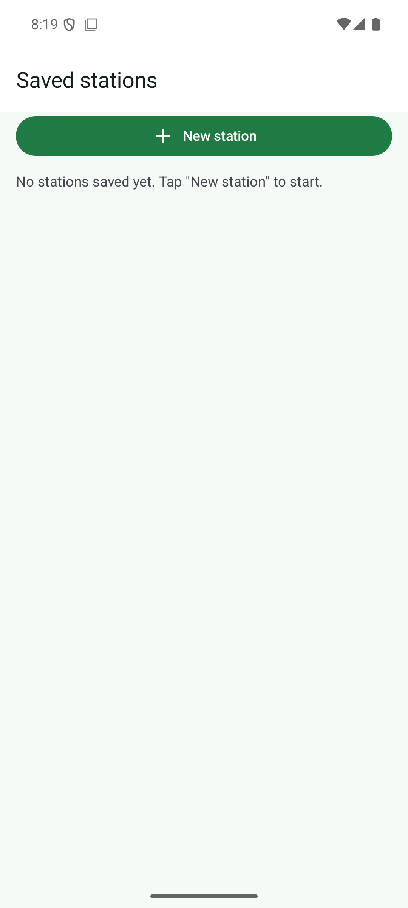 | 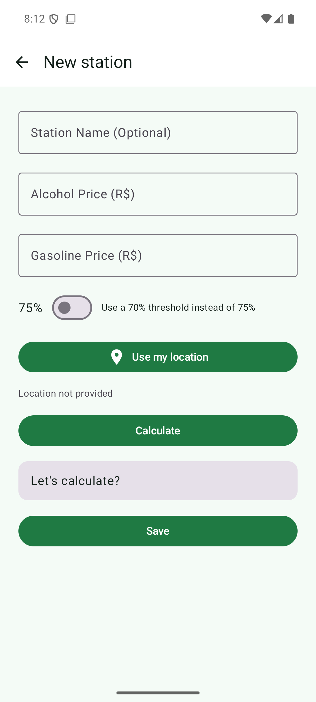 | 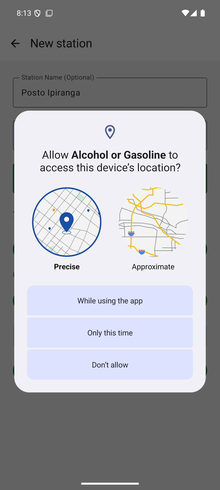 |

| Localização obtida | Cálculo | Lista com posto |
|---|---|---|
| 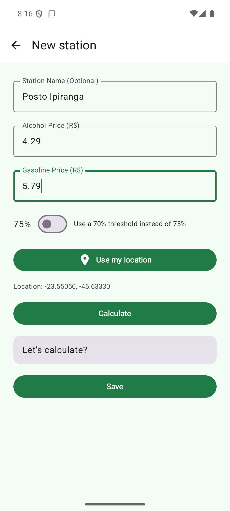 | 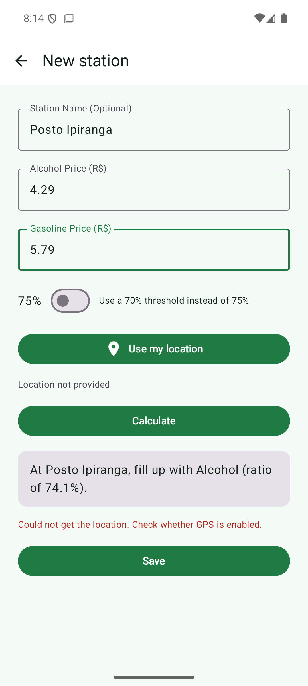 | 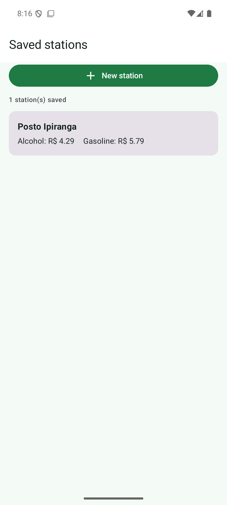 |

Na captura do cálculo aparece também o aviso de que a localização não pôde ser obtida —
é o app informando o usuário quando o GPS está indisponível.

| Detalhe | Mapa | Edição |
|---|---|---|
|  | 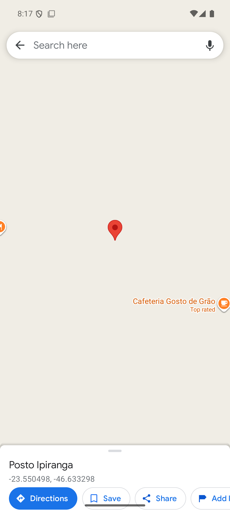 | 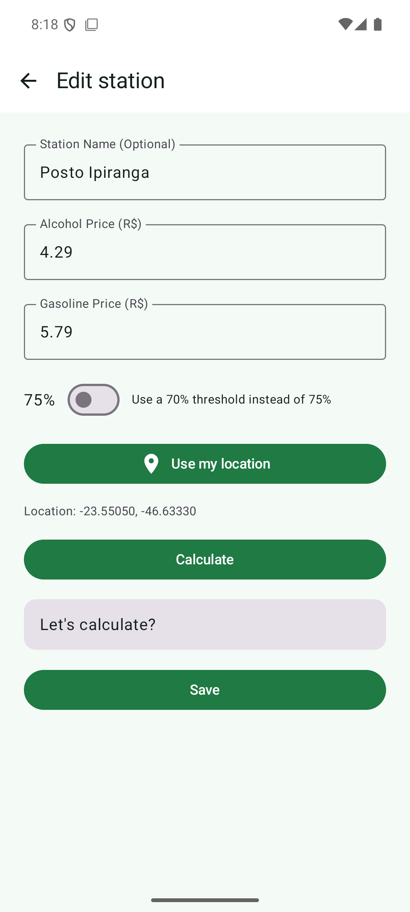 |

| Detalhe atualizado | Exclusão | Switch restaurado |
|---|---|---|
| 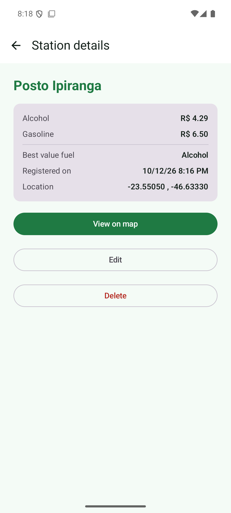 | 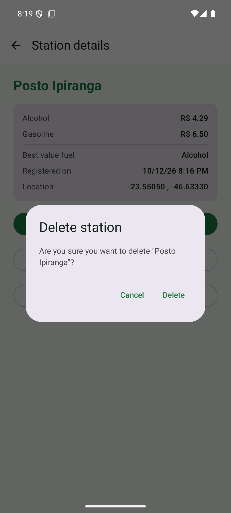 | 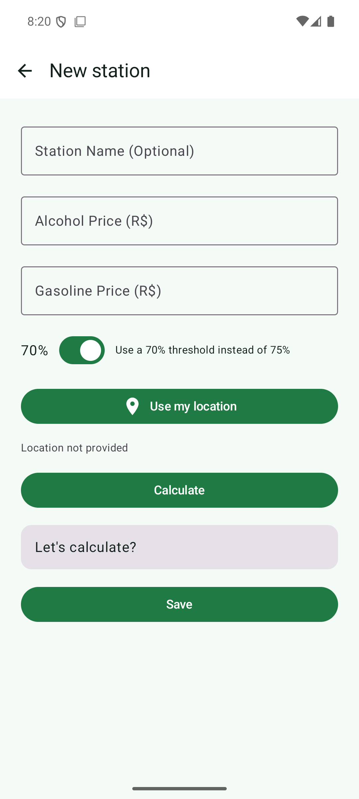 |

A captura do switch restaurado foi tirada **depois** de encerrar o processo do app
(`am force-stop`) e abri-lo de novo: o switch voltou ligado em 70%.

## Internacionalização em execução

Mesmas telas com o sistema em português:

| Formulário (pt-BR) | Resultado (pt-BR) | Lista (pt-BR) | Detalhe (pt-BR) |
|---|---|---|---|
| 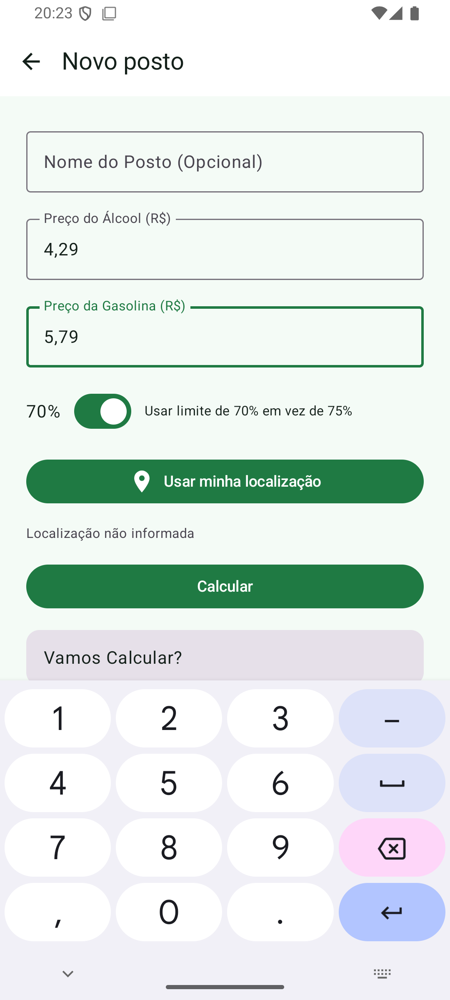 | 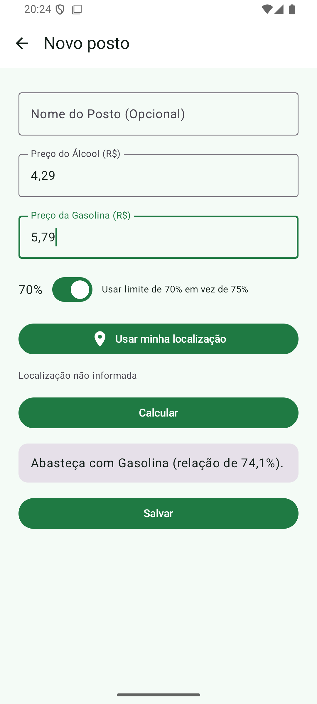 | 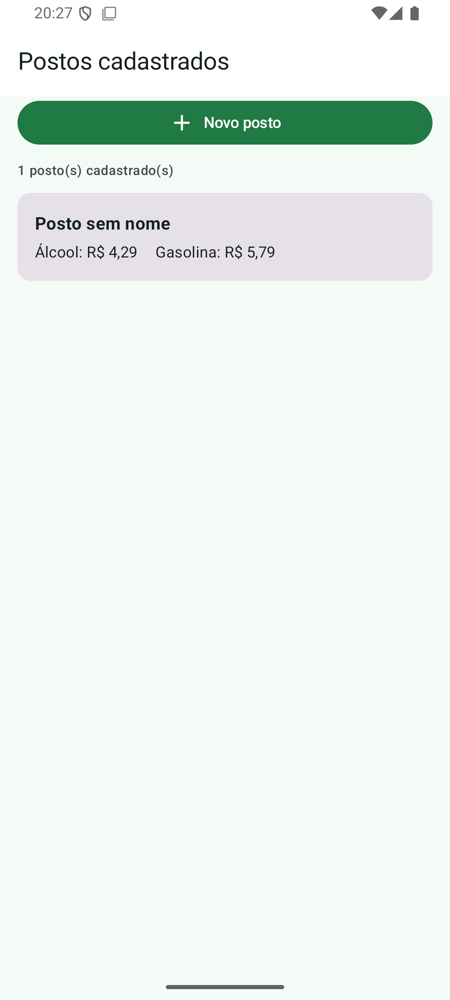 | 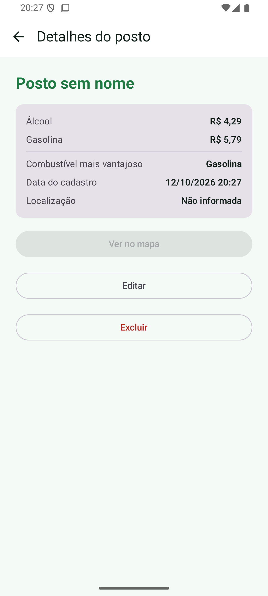 |

Repare que a razão é exibida como **74,1%** (vírgula) e os preços como **R$ 4,29** — o
formato numérico acompanha o locale.

## Estrutura

```
app/src/main/java/com/example/myapplication/
├── MainActivity.kt          # NavHost com as três rotas
├── data/
│   ├── Posto.kt             # modelo serializável
│   └── PostoRepository.kt   # CRUD em SharedPreferences + JSON
├── ui/
│   ├── Rotas.kt             # rotas type-safe do Navigation
│   ├── ListaScreen.kt
│   ├── FormularioScreen.kt
│   ├── DetalheScreen.kt
│   └── Formato.kt           # formatação numérica por locale
└── util/
    └── Localizacao.kt       # permissão, obtenção do fix e Intent do mapa

app/src/main/res/
├── values/strings.xml       # português
└── values-en/strings.xml    # inglês
```

## Decisões técnicas

- **Navigation Compose com rotas type-safe** (`@Serializable` + `toRoute<T>()`) em vez de
  rotas por string, que é a API atual da biblioteca e evita erro de digitação em
  argumentos.
- **`LocationManager` do framework, sem Google Play Services.** A última posição
  conhecida é suficiente para gravar um posto, e isso evita uma dependência extra.
  Quando não há posição em cache, o app pede um fix novo aos provedores e espera até
  10s — `getLastKnownLocation` sozinho devolve `null` em aparelho recém-ligado, o que
  deixaria o botão sem efeito.
- **SharedPreferences com a lista serializada em JSON.** O volume de dados é pequeno
  (postos de um usuário) e atende ao que a atividade pede; Room seria exagero aqui.
- **Um repositório único**, criado na `MainActivity` e passado às telas. As telas releem
  os dados ao entrar em composição, então edições e exclusões feitas em outra tela
  aparecem ao voltar.
